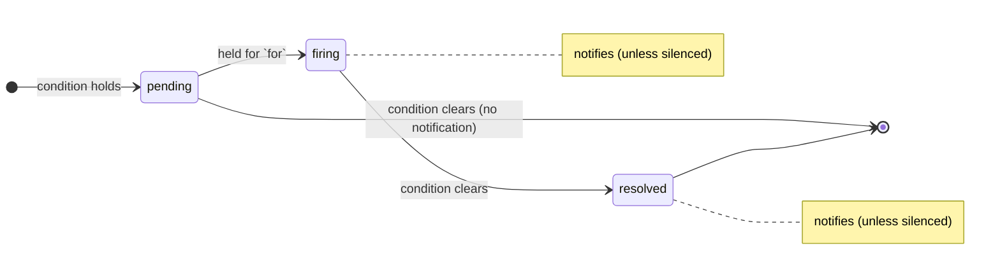

# Alerts

Rules live in `alerts.yaml` (next to the dashboards directory, or
`ATALAYA_ALERTS`). The server evaluates them every `defaults.every`,
`ATALAYA_NOW_DELAY` behind the clock like the dashboards, re-reading the file each time. An invalid file
keeps the previous rules and shows the error on the alerts page.

```yaml
defaults:
  every: 30s          # evaluation interval
  for: 5m             # how long a condition must hold before firing
  group_wait: 30s     # notifications that happen within this window go together
  notify: [default]   # channels used by rules without their own `notify`

channels:
  default:
    type: log         # the server's log
  phone:
    type: ntfy
    url_env: ATALAYA_NTFY_URL       # https://ntfy.sh/my-topic
    token_env: ATALAYA_NTFY_TOKEN   # optional
  # telegram: { type: telegram, bot_token_env: …, chat_id_env: … }
  # hook:     { type: webhook, url_env: … }   POSTs a JSON with the alerts

rules:
  - id: disk-full
    title: { en: "Disk almost full", es: "Disco casi lleno" }
    severity: warning                 # info | warning | critical
    expr: '100 * (1 - node_filesystem_avail_bytes / node_filesystem_size_bytes) > 90'
    for: 10m
    summary: { en: "{{mountpoint}} on {{instance}} at {{value}} %", es: "{{mountpoint}} en {{instance}} al {{value}} %" }
    notify: [phone]
  - id: app-errors
    title: "Errors in my-app"
    kind: logs
    filters: ["service:my-app", "level:ERROR"]   # same syntax as the logs explorer
    window: 10m
    threshold: 20
    severity: warning
```

## Rule types

- **PromQL** (`expr`): every series the instant query returns is one alert,
  identified by its labels (`labels: [...]` limits which labels count).
  `up{job="node-exporter"} == 0` gives one alert per host that is down.
- **Logs** (`kind: logs`): fires when the number of lines matching `filters` in
  `window` reaches `threshold`.

`summary` substitutes `{{label}}` and `{{value}}`; without one, the alert shows
its value. Texts are a string or `{en, es}`.

## Lifecycle



An alert goes through *pending* (the condition holds, but not yet for `for`),
*firing* and *resolved*. Every transition is appended to
`ATALAYA_DATA/alerts/history.jsonl` (rotated at 8 MiB) and shown on the
timeline. The state survives restarts (`alerts/state.json`).

Silences match a rule and/or labels until an end time, with a comment. Silenced
alerts are still evaluated and visible, they just do not notify. Manage them on
the alerts page or through the API.

## Notifications

Transitions are queued per channel in a persistent outbox
(`ATALAYA_DATA/alerts/outbox.json`) and delivered by their own loop, so a slow
channel never delays evaluation. A failed delivery is retried with growing
waits (30 s, 90 s… up to 1 h) and given up after 24 attempts, with an error in
the log. Delivery is at-least-once.

Secrets never go in the YAML: a channel names the environment variables that
hold them (`url_env`, `token_env`, `bot_token_env`, `chat_id_env`). The alerts
page shows whether each channel has its variables. `ATALAYA_PUBLIC_URL` adds a
link to the UI to every notification. Notifications are sent on transitions;
there are no periodic reminders for alerts that stay firing.

## API

| Method and path | What |
|---|---|
| `GET /api/v1/alerts` | Rules, their state and instances, channels, silences, outbox size |
| `GET /api/v1/alerts/history?range=7d` | Transitions |
| `POST /api/v1/alerts/{id}/test` | Evaluate one rule now, without touching the state |
| `GET` / `POST /api/v1/alerts/silences` | List or create silences: `rule`, `labels`, `until` (a duration like `2h` or an RFC 3339 date), `comment` |
| `DELETE /api/v1/alerts/silences/{id}` | Remove a silence |
