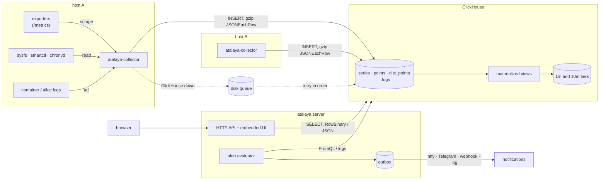
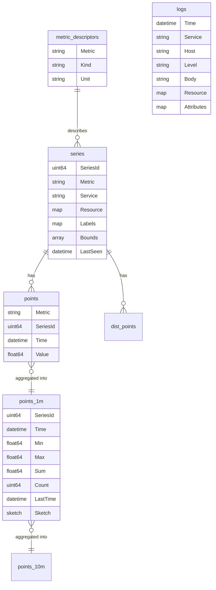
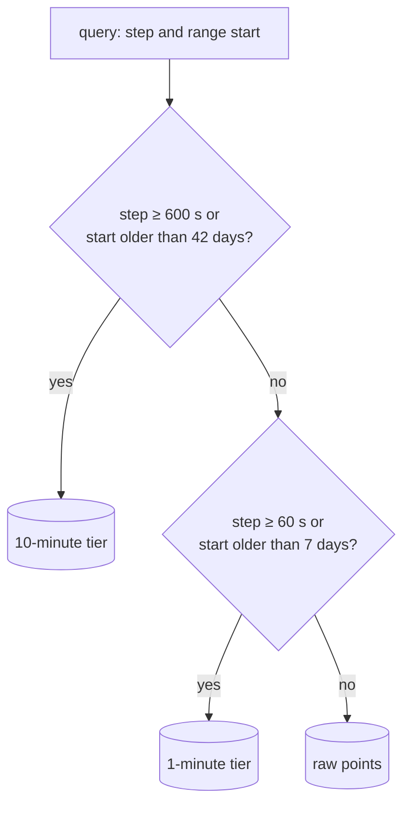
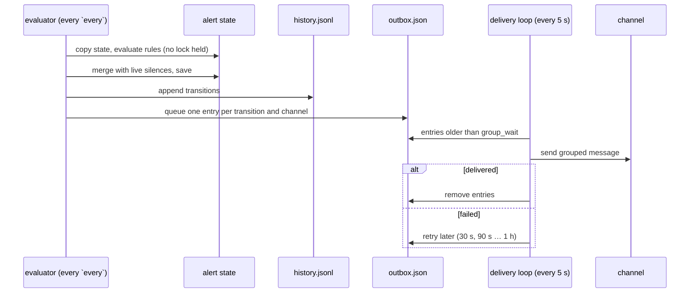

# Architecture

## Components

**Collector** (`atalaya-collector`), one per host. Every scrape interval it
gathers metrics from Prometheus endpoints (static targets, or Nomad services
tagged `metrics=true`) and from the host itself (sysfs, `smartctl`, chronyd). It
applies the metric rules (allow lists, drops, aggregation), registers each new
series once and then only sends points. It also tails logs (Nomad allocs and/or
Docker containers). Everything is batched per table and sent every `flush_interval`;
failed batches go to an on-disk queue that is retried in order. See
[collector](collector.md).

**ClickHouse** stores everything. The schema (`atalaya-server schema --apply`) creates
the tables and the materialized views that build the aggregated tiers at insert
time.

**Server** (`atalaya`) answers the UI and the HTTP APIs, evaluates alert rules
and delivers notifications. It only needs a read-only ClickHouse user. The UI is
embedded in the binary; dashboards, the home page, the timeline and alert rules
are YAML files it reads from disk (see [configuration](configuration.md)).
Notebooks, saved searches and alert state live in `ATALAYA_DATA`.

## Data model

| Table | Content | Retention |
|---|---|---|
| `metric_descriptors` | One row per metric: kind (gauge, cumulative, distribution), unit, description | forever |
| `series` | One row per series: metric, service, resource labels (`host.name`, `nomad.*`), metric labels, bucket bounds for distributions, `LastSeen` | forever |
| `points` | Scalar points: series, time, value | 7 days |
| `points_1m`, `points_10m` | Per bucket: min, max, sum, count, time of the last sample, DDSketch | 6 weeks / forever |
| `dist_points` (+ `_1m`, `_10m`) | Histograms: count, sum and cumulative buckets | 7 days / 6 weeks / forever |
| `stale` | When a series stopped being written (staleness markers) | 6 weeks |
| `logs` | Time, service, host, stream, level, body, resource and JSON attributes | forever |

A series is identified by a hash of its metric, service, resource and labels.
The collector sends the series row the first time it sees it (and again every
hour to refresh `LastSeen`) and afterwards only points, which keeps inserts
small.

In PromQL, the service is the `job` label and `host.name` the `instance` label.

## Tiers

The materialized views write the three tiers on every insert, so even the
aggregated tiers have recent data. A query reads the coarsest tier that still
has the resolution its step needs and still holds its oldest point:

| Tier | Resolution | Used when |
|---|---|---|
| raw | the scrape interval (15 s by default) | step < 60 s and the range starts less than 7 days ago |
| 1 minute | 60 s | step < 600 s and the range starts less than 42 days ago |
| 10 minutes | 600 s | everything else |

A bucket reads as its mean for gauges and its maximum for counters, stamped
with the time of its last sample, so `rate()` and counter resets behave across
tiers; min and max keep peaks visible after downsampling. See [querying](querying.md) for what this means for results.

## Alerts

The server evaluates every rule each `every` seconds on a copy of its state, then
merges the result with the live silences. Transitions are appended to a history
file and queued per channel in a persistent outbox, which a separate loop
delivers with exponential backoff. See [alerts](alerts.md).
