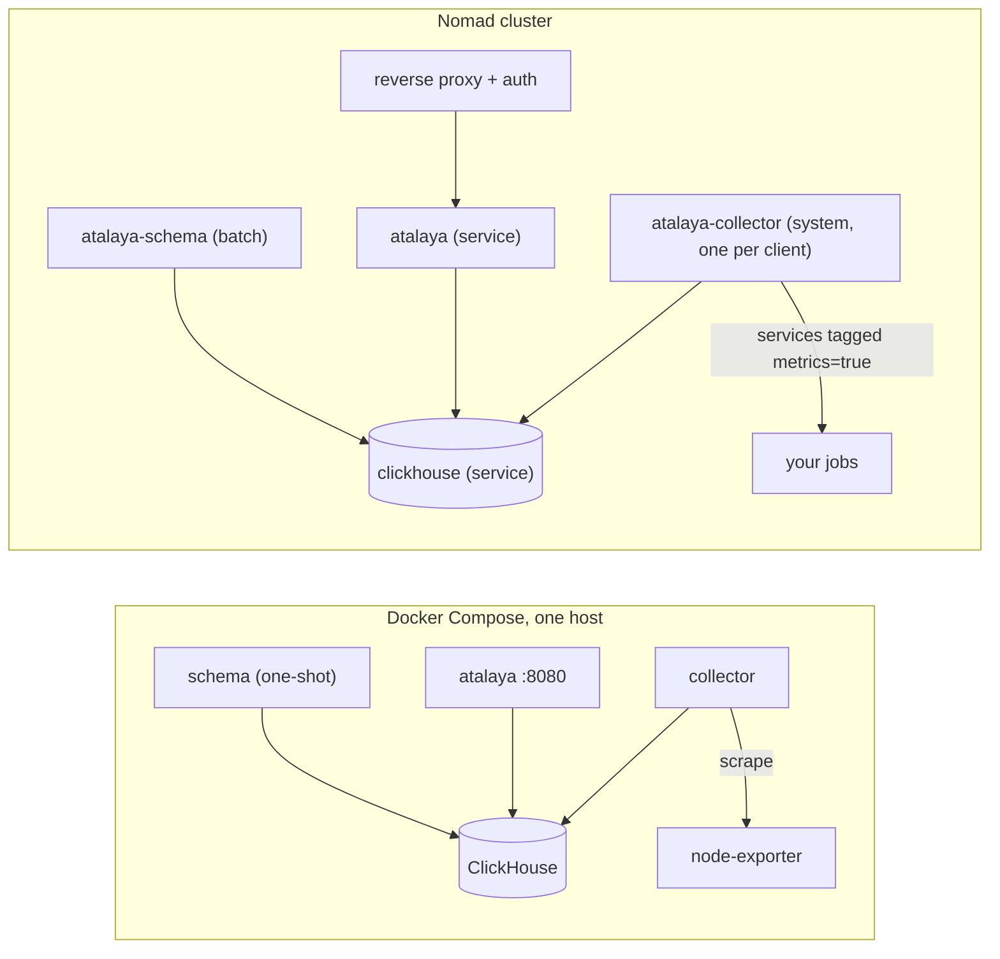

# Deployment

Atalaya needs ClickHouse, one server and one collector per host. Ready-made
setups:

- **Docker Compose** (one host): [examples/compose](../examples/compose/README.md).
- **Nomad** (a cluster): [examples/nomad](../examples/nomad/README.md), with a
  ClickHouse job, the schema as a batch job, the server and the collector as a
  system job.



Both use the images `ghcr.io/mariojcr/atalaya-server` and
`ghcr.io/mariojcr/atalaya-collector` (amd64), tagged by release
(`X.Y.Z`, `X.Y`, `latest`); pin a version in production. See
[releasing](releasing.md#image-tags) for all tags.

## Without containers

Build both binaries from source (`cargo build --release` at the root of this
repository) and install them:

```sh
sudo install -m 755 target/release/atalaya-server target/release/atalaya-collector /usr/local/bin/
```

The collector needs `smartctl` (package `smartmontools`) for disk health. Example
systemd units:

```ini
# /etc/systemd/system/atalaya-collector.service
[Unit]
Description=atalaya collector
After=network-online.target
Wants=network-online.target

[Service]
ExecStart=/usr/local/bin/atalaya-collector /etc/atalaya/collector.yaml
EnvironmentFile=/etc/atalaya/collector.env    # CLICKHOUSE_PASSWORD=…
StateDirectory=atalaya-collector              # state_dir: /var/lib/atalaya-collector
Restart=on-failure
TimeoutStopSec=30

[Install]
WantedBy=multi-user.target
```

Running directly on the host, the collector reads sysfs at `/`: set
`host.root: /` in its configuration. It runs as root to read SMART and the
RAPL energy counters.

```ini
# /etc/systemd/system/atalaya.service
[Unit]
Description=atalaya server
After=network-online.target
Wants=network-online.target

[Service]
ExecStart=/usr/local/bin/atalaya-server
EnvironmentFile=/etc/atalaya/atalaya.env      # CLICKHOUSE_*, ATALAYA_DASHBOARDS=/etc/atalaya/dashboards
Environment=ATALAYA_DATA=/var/lib/atalaya
StateDirectory=atalaya
DynamicUser=yes
Restart=on-failure

[Install]
WantedBy=multi-user.target
```

## ClickHouse

Tested with ClickHouse 26.8. Create the schema once and after every upgrade
(idempotent):

```sh
CLICKHOUSE_URL=http://clickhouse:8123/ CLICKHOUSE_USER=admin CLICKHOUSE_PASSWORD=… atalaya-server schema --apply
```

### Replicated ClickHouse

On a cluster of replicas, set `ATALAYA_REPLICATED=1` when applying the schema.
Every `*MergeTree` table becomes its `Replicated*MergeTree` without arguments,
so the servers need `default_replica_path` and `default_replica_name` (for
example `/clickhouse/tables/{uuid}/{shard}` and `{replica}`). The schema does
not create the database: create it first on every replica, against itself,
with `ENGINE = Replicated('/clickhouse/databases/atalaya', '{shard}', '{replica}')`.
A `Replicated` database replicates the DDL but does not convert table engines,
and one connection to one replica cannot create it on the others; the schema
refuses to run while the database is missing or is not `Replicated`. The server
and the collectors need nothing else: they can reach any replica, for example
through a load balancer.

Users, one per job so that a leaked password gives away as little as possible
([examples/compose/clickhouse-users.xml](../examples/compose/clickhouse-users.xml)
sets them up):

- **The schema:** a user that can create databases, tables and materialized
  views (an admin).
- **The server:** `SELECT` on `atalaya.*` and `readonly` 2 (read-only, but it
  may set query settings).
- **The collectors:** `INSERT` and `SELECT` on `atalaya.*`. They insert into
  `series`, `metric_descriptors`, `points`, `dist_points`, `stale` and `logs`,
  and the materialized views that fill the aggregate tiers run as the inserting
  user.

Storage grows with the number of series and log volume. Raw points expire after
7 days and 1-minute aggregates after 42 days (cleaned once a day, so they can
stay up to a day longer); 10-minute aggregates, series and logs are kept
forever, so watch the disk (the example `disk-full` alert covers the host).
The tables use a fine index granularity (512 to 2048 rows), so ClickHouse keeps
more marks in memory: a `mark_cache_size` of about 1 GiB fits them.

## Server

A single instance (alert state and notebooks are local files). Give it a
persistent `ATALAYA_DATA` directory and a read-only ClickHouse user.

- **Container image:** it runs as `atalaya`, uid and gid 10001, with
  `ATALAYA_DATA=/var/lib/atalaya`. A new named volume mounted there takes that
  owner from the image; a host directory, or a volume an earlier image created
  as root, needs it once:
  `docker run --rm --user 0 --entrypoint chown -v <volume>:/var/lib/atalaya ghcr.io/mariojcr/atalaya-server -R 10001:10001 /var/lib/atalaya`
  (or `chown -R 10001:10001` on the host directory).
- **Sign-in:** with `ATALAYA_OIDC_ISSUER` set (see
  [Configuration](configuration.md#sign-in)), every page and API call needs a
  session from your OpenID Connect provider. Without it there is no
  authentication: anyone who reaches the port can read everything, edit
  notebooks and create silences, so keep it on a private network or behind a
  reverse proxy with authentication.
- **Health:** `/healthz` answers while the process runs (use it for restarts);
  `/readyz` returns 503 when ClickHouse does not answer and reports how long ago
  alerts were evaluated (use it for load balancers and monitoring).
- **Errors:** API errors caused by ClickHouse return 502; invalid requests 400.
- It stops cleanly on SIGTERM.

## Collector

One per host, with the host's `/` mounted read-only at `/host` (sysfs metrics),
a persistent `state_dir` (log positions and the disk queue), and:

- `privileged` (or raw disk access) only if SMART is enabled;
- the Nomad alloc directory mounted read-only when using Nomad, or the Docker
  containers directory for Docker logs;
- host networking, or a network from which it reaches the targets it scrapes.

On SIGTERM it finishes the send in flight and flushes what is pending; give it a
few seconds (`kill_timeout`, `stop_grace_period`).

## Upgrades

1. Run `atalaya-server schema --apply` with the new version (it only adds what is
   missing).
2. Replace the server, then the collectors. Collectors queue to disk while
   ClickHouse or the network is unavailable, so the order is not critical.

## Backups

Everything worth keeping is in ClickHouse plus the server's `ATALAYA_DATA`
(notebooks, saved searches, alert history, silences). Back up ClickHouse with
its native `BACKUP DATABASE atalaya TO …` (or volume snapshots) and copy
`ATALAYA_DATA`. The collectors' `state_dir` holds only positions and an
in-flight queue.
